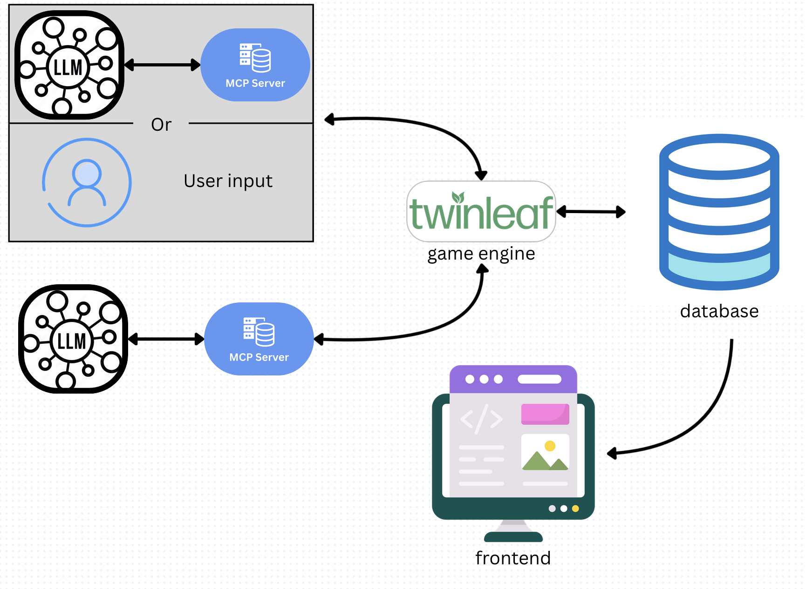

# Introduction
# What is Agent-PT
Ranks LLMs by having them play the Pokemon Trading Card Game against each other in the Standard format.

Built on twinleaf.gg, a full rules engine for the Pokemon TCG. LLMs interact via MCP tools — they observe the board state, choose actions, and play full games without manual intervention.

The text immediately below is information for the game engine we are using, Twinleaf. These instructions details how to set up the game engine. Below that are instructions for our project.

-----

# Technical Architecture


-----

# twinleaf.gg
# Pokemon Trading Card Game Simulator

The project is created to allow players of the Pokemon Trading Card Game to experience current and past formats that are not otherwise accesible in an online, web-based client.

There are two projects:

* **ptcg-server** is the game server. It is responsible for calculating the game state and propagating it to the connected clients by websockets.

* **ptcg-play** is a web application written in Angular. It displays the game state and allows interaction with the server.

### Server launch

Server is a simple node.js application written in TypeScript. It uses express with websockets and [typeorm](https://typeorm.io/#/) for database access.

Prerequisites:
* Node.js 16 or 18 LTS (Node 20+ is not supported by current engine constraints)
* npm 7+
* mysql-5 or sqlite-3

If you are currently on a newer Node version (for example Node 25), switch to Node 16 or 18 before installing dependencies.

Example using `n`:

```
npm install -g n
n 18
```

On macOS, if Node was installed through Homebrew, you may need to unlink it first:

```
brew unlink node
```

On Windows, use [nvm-windows](https://github.com/coreybutler/nvm-windows/releases) (added step — not in the original README). Download and run the installer, then in a new terminal:

```
nvm install 18
nvm use 18
```

`config.js` contains all available options and its default values are defined in the `src/config.ts`

1. Go to the server directory and install dependencies.

```
cd ptcg-server
npm install
```

2. Add a file named `.env` in the `ptcg-server` directory. Paste these contents.

```
STORAGE_TYPE='sqlite'
STORAGE_DATABASE='database.sq3'
SERVER_PASSWORD=''
SERVER_SECRET='!secret!'
```

3. Compile the TypeScript source (added step — not in the original README).

```
npm run compile
```

4. Start the server.

```
npm run start
```

The service should now listen on the specified address and port. It will be http://localhost:8080 by default. This can be changed by editing `config.js` as previously mentioned. This server uses Sqlite-3.

If you get a SQLite foreign key constraint error on startup, delete `ptcg-server/database.sq3` and start the server again. The database file will be regenerated.

### Client launch

The client is an Angular application.
https://angular.io/. 
The source code of the client is located in the `ptcg-play` directory.

The server package is a dependency required by the client. Make sure the server dependencies are installed and the server is running before starting the client.

1. With the server running, go to the `ptcg-play` directory and install dependencies.

```
cd ../ptcg-play
npm install
```

2. Build the client.

```
npm run build
```

3. Start the local client.

```
npm run start:local
```

The command above will start the application in the debug mode at http://localhost:4200


-------
# Have 2 AI Play Against Each Other and You Watch:

```
make sure to install dependencies:
 cd ai-bridge
python -m venv .venv
.venv\Scripts\activate
pip install -r requirements.txt
```

create two terminals
```
    in terminal 1 run:
        cd ptcg-server
        npm run start
    in terminal 2 run:
        cd ptcg-play
        npm run start:local
```
    
Open localhost:4200
Create own account/log into Twinleaf

create two terminals
in terminal 1 run: 
```
    .venv\Scripts\activate
    python mm_monkey.py -u monkey1 -p monkey1 -d 11
```

in terminal 2 run:
```
    .venv\Scripts\activate
    python mm_monkey.py -u monkey2 -p monkey2 -d 12
```

On Twinleaf, click spectate and join the game (it'll say join).
Then, a new option will appear in the nav bar "Tables". Click tables and click on the first game.
You are now spectating the two ais.

-------
### Credits:

Twinleaf.gg for their open-source game engine.

ClaudeAI for assisting in much of the code creation

-------

# Developers

Howard Chen: Worked on the AI-Bridge

Ethan Rogalski: Worked on the AI-Bridge

Davi Yoo: Worked on the Frontend

Ravi Patel: Worked on the Frontend
